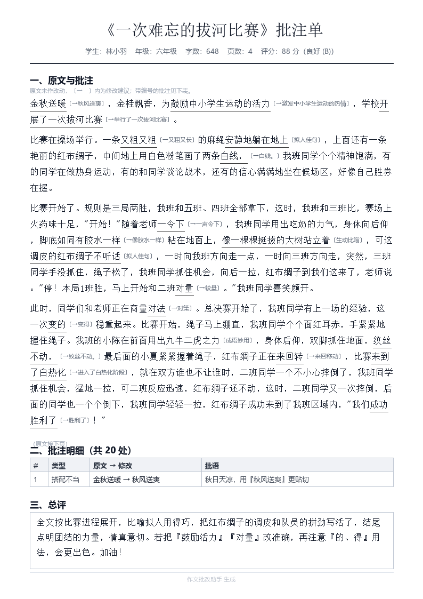

# 开发说明

面向开发者。老师使用请看 [使用说明.md](使用说明.md)。

纯静态页面，**没有后端**。识别与批改全部由 DeepSeek 完成，密钥由使用者在浏览器里自己填（BYOK）。

## 本地运行

```bash
npm install
cp .env.example .env      # 填入 DEEPSEEK_API_KEY（可选，见下）
npm run dev
```

打开 http://localhost:5173 。`npm run dev` 已开启局域网监听，同一 Wi-Fi 下手机可直接访问 `http://<你电脑的局域网IP>:5173`。

### 本地测试用 .env（可选）

`.env` 里的 `DEEPSEEK_API_KEY` **只在 `npm run dev` 时**被内联进开发版页面，省去每次手填密钥。

实现方式是 `vite.config.ts` 里的 `dev-secrets` 虚拟模块，**不是** `define` —— Vite 的 `define` 只在 `build` 时生效，`serve` 下占位符会原样送到浏览器。该模块在非 development 模式下固定返回空字符串，所以 `npm run build` 的产物里**永远不含密钥**。

## 部署到 GitHub Pages

没有后端，密钥由使用者在页面里自己填。已实测 DeepSeek 接口会回显 `Access-Control-Allow-Origin`，因此浏览器可以直连，静态站点完全可行。

1. 推到 GitHub 仓库
2. Settings → Pages → Source 选 **GitHub Actions**
3. push 到 `main` 即自动构建发布（见 `.github/workflows/pages.yml`）

`vite.config.ts` 用 `base: './'`，因此**任何仓库名或自定义域名**都能直接用，无需改配置。构建还会自动生成 `dist/404.html` 以支持刷新和深链接。

## BYOK：密钥键名

密钥只存在**本机浏览器 localStorage**，扁平键名，启动时自动读取：

| 键名 | 说明 |
| --- | --- |
| `deepseek-zuowen-key` | DeepSeek API Key（必填） |
| `deepseek-zuowen-base` | 自定义 API 地址（选填，用于代理/兼容网关） |

可在页面「设置」里填写，也可事先注入：

```js
localStorage.setItem('deepseek-zuowen-key', 'sk-...');
```

> 密钥不会上传到任何服务器，只随请求发往 `api.deepseek.com`。
> 注意这是公开站点，请勿在公用电脑上保存密钥。

## 架构

```
shared/          浏览器与测试脚本共用的核心逻辑（纯 ESM，无 Node 依赖）
  prompts.mjs      prompt 构造（图片 + 输出结构说明）
  normalize.mjs    结果归一化 + 批注定位
  deepseek.mjs     调用、重试、截断 JSON 修复、错误文案
  queue.mjs        后台队列调度（纯函数，便于测试）
src/
  hooks/          后台队列、屏幕常亮
  utils/          BYOK 密钥、批改流程、评分配色、角标规则、IndexedDB
  data/           使用介绍文案（helpContent.ts）
  components/     移动端界面
scripts/          测试脚本 + 文档配图生成（Python，见下）
test/             真实作文照片（不入库，自行放入即可跑 e2e）
docs/             README 里的界面示意图
```

### 使用介绍是单一来源

应用内的「使用介绍」（`src/components/HelpSheet.tsx`）首次打开自动出现一次，之后靠顶栏
问号反复打开；与仓库里的 `使用说明.md` 讲的是同一件事，两份文案必然会漂移，而且漂移
是**静默的** —— 老师看到其中一份，另一份就是错的。已看过的标记在
`localStorage` 键 `deepseek-zuowen-intro-seen`。

所以文案统一放在 `src/data/helpContent.ts`，组件只负责渲染；
`scripts/test-doc-consistency.mjs` 会断言两份文档里的关键事实（申请地址、按钮名称、
「几分钱」「30～90 秒」「保管好」「泄露」等）**同时存在**，并覆盖全部六个步骤。
改了界面文案却只更新一处时，`npm test` 会直接报错。

`docs/*.png` 是**示意图**（开发环境里没有浏览器），由 `scripts/render-*.py` 用 Pillow 绘制，需要 Python + Pillow，不属于应用运行依赖。

### 批注定位（最关键的一环）

模型给的字符下标经常不准，所以 `normalize.mjs` **只信任 `originalText`**，重新在转写正文里定位并校验；定位不到的批注直接丢弃，宁可不标也不错标。真实 4 页作文实测 **20/20 全部精确命中**。

### 模型与成本

`deepseek-flash` 同时支持图片输入与 JSON 输出，1M 上下文。

- 图片按尺寸折算 token，每张上限 **1024**，所以多页上传很便宜
- 思考模式会产生较多 reasoning token（4 页实测约 1.1 万–2 万），按输出计费，因此 `max_tokens` 留了充足余量
- 空闲时段（含周末与工作日 18:00 之后）价格为高峰时段的一半

## 设计取向：不打扰，提效率

使用者是**小学语文老师**，通常一只手举手机、另一只手拿红笔，时间被课间和晚上切碎。她真正的成本不是"等 AI"，而是**把批语一笔一画抄到作文本上**。所以每个取舍按这几条定：

- **屏幕不能被她以外的东西拿走**。不抢屏、不弹窗、没有需要她关闭的东西。
- **不要她"注意到"**。网络抖一下应该自己恢复；只有她能解决的问题（密钥错、余额不足）才允许浮出来。
- **她低头写字时屏幕不能黑**。批改结果打开期间持有 Wake Lock（iOS 不支持则静默跳过）。
- **批语要短、要有编号、要按阅读顺序**。她是在纸上找位置写，不是在网上读文章。
- **等待要被藏起来**。批改放后台，提交完立刻能拍下一篇。

具体落地：后台队列、完成提示 6 秒自动消失、只在真正空闲时自动打开结果、失败自动静默重试（最多 2 次，指数退避）、抄写清单可一键复制。

## 后台批改队列

批改跑在**后台队列**里，和屏幕脱钩。提交一篇立刻能拍下一篇。

- 顶部只有**一条细状态线**，不弹窗、不挡操作；空闲时完全不显示
- **绝不抢焦点**：正在抄某一篇时，后面批好的只在旁边安静排队
- 同时批 **2 篇**（`MAX_CONCURRENT`），队列上限 20 篇
- 队列存进 IndexedDB，刷新或息屏后继续；中途被打断的会重新排队
- 失败的单篇可单独重试，不影响其他

调度逻辑抽在 `shared/queue.mjs`（纯函数），由 `npm test` 守住三条不变量：同一篇不会重复开跑（避免重复计费）、并发不超上限、不打断正在阅读的结果。

## 导出批注文档

「批改记录」里点**选择**可多选（或全选当前筛选结果），再点**导出批注文档**，用浏览器的「打印 → 另存为 PDF」得到 PDF。



**用打印排版而不是 JS PDF 库**，原因是中文：矢量文字、字形正确、可选可搜索，不必嵌入 5–10 MB 的 CJK 字体，也不必把页面栅格化成图片。

**颜色只用标记，不用色块**：学校打印机多为黑白激光，大面积色块打出来是灰糊糊一片还费墨。所以颜色落在文字与细线上，黑白打印依然清楚，彩色时又能一眼扫到。

必须声明 `print-color-adjust: exact` —— 浏览器打印默认会丢弃背景色和部分文字装饰色，不声明的话颜色会被静默抹掉。

文档结构（每篇一页）：原文与批注 / 批注明细表 / 总评。一页放不下时由浏览器分页，表头会自动在每页重复，单行不会被切断。


## 颜色语义（一个颜色只有一个含义）

| 颜色 | 含义 |
| --- | --- |
| **玫红** | **待你处理**：右上角角标（= 有几篇批好还没看）、列表里的「新」 |
| **绿** | **操作成功**：复制成功、密钥已保存、批改完成 |
| **琥珀** | 成绩 80–89（良好） |
| **红** | 成绩 <80（待提升） |
| 批注四色 | 错别字红、病句橙、标点紫、好句子金（波浪线） |

右上角角标过去会在绿/红之间切换（同一位置两种含义，看不懂），现在**只表示"待你查看的篇数"**，看完即消失。规则抽在 `src/utils/historyBadge.ts`，由 `npm test` 守着，确保它永远只有一种含义。

同理，成绩颜色按分数走（≥90 绿 / 80–89 琥珀 / <80 红）——早先所有等级都是绿色，会让「待提升 C」看起来同样让人放心。

## 测试

```bash
npm test             # 纯逻辑单测，不需要网络与密钥
npm run test:e2e     # 真实调用 DeepSeek 跑通作文，校验全部契约
npm run typecheck    # 类型检查（已开启 noUnusedLocals，禁止死代码堆积）
```

`npm test` 覆盖：**编码防回归**（防止 shell 回写把中文变成乱码）、**使用介绍与文档一致性**、评分配色语义、右上角角标规则、后台队列不变量（不重复开跑 / 并发上限 / 不抢焦点）、批注定位、截断 JSON 修复。

`npm run test:e2e` 会把 `test/` 里的照片（默认全部）发给 DeepSeek，断言：标题非空、分数区间、总评 80–100 字、批注数量、维度分之和等于总分、**批注 100% 精确锚定**、批语长度可抄写、CORS 回显。`test/` 不入库，自己放 1–4 张照片进去即可；没有照片时脚本会提示并跳过。

`npm run fixture` 把一次真实批改结果存成 `scripts/fixture-result.json`，供界面单测复用。

## 已知取舍

- 手写体识别偶有偏差，正式使用前建议对照原图核对
- 模型偶尔会把建议写得偏长，prompt 已约束，仍可能个别出现
- 批改记录存在浏览器 IndexedDB，换设备或清缓存会丢失
- 导出用浏览器打印生成 PDF，因此在极少数屏蔽 `window.print` 的内嵌浏览器里可能不可用
